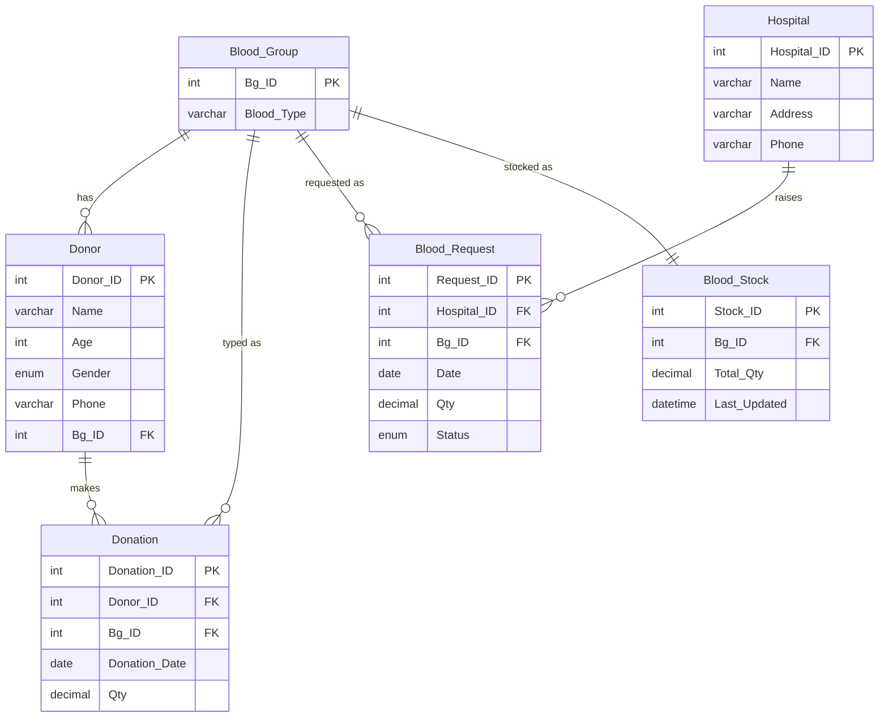

# Blood Bank Management System

A small, MySQL-focused **DBMS Lab project**: a web application that manages blood
donors, blood groups, donations, hospitals, hospital blood requests and available
blood stock. The **database is the core of the project**; the Python/Flask
backend is deliberately lightweight and writes plain SQL (no ORM).

---

## 1. Project Title

**Blood Bank Management System** — a web-based database application built with
MySQL 8 and Python Flask.

---

## 2. Introduction

Blood banks must track who donated what, when, and in which blood group, while
hospitals continuously request blood units. Doing this on paper or in
spreadsheets causes errors, duplicate donors, lost history and, worst of all,
incorrect stock counts. This project models the whole workflow in a relational
database and exposes it through a simple web interface. Every important piece of
data lives in MySQL; nothing important is hard-coded in the application.

---

## 3. Problem Statement

Design and implement a blood bank system that:

- stores donors and their blood groups without duplication,
- records each donation and keeps a per-blood-group stock quantity in sync,
- lets hospitals raise requests and tracks their status,
- guarantees that stock can never go negative and that a request can never
  deduct stock twice,
- answers reporting questions with SQL joins and aggregate queries.

---

## 4. Objectives

1. Design a normalised relational schema (six core tables) with proper keys,
   constraints and referential actions.
2. Insert realistic, internally consistent sample data.
3. Demonstrate joins, aggregation, filtering and transactions with at least 15
   practical SQL queries.
4. Build a working Flask UI that performs real CRUD against MySQL.
5. Protect data integrity with **transactions** and **row locking** for the two
   stock-changing workflows (donation, request fulfilment).
6. Keep the code small enough for a university student to read and explain.

---

## 5. Proposed Features

- Donor CRUD, search by name/phone, filter by blood group, donation history.
- Donation registration with automatic stock increase (atomic transaction).
- Blood stock view with low-stock highlighting.
- Hospital CRUD and per-hospital request history.
- Blood request lifecycle: Pending → Approved → Completed, or Pending → Rejected.
- Fulfilment that locks stock, checks availability, deducts and completes
  atomically (never negative, never double).
- Dashboard with live counts and stock.
- SQL Reports page showing joins and aggregates with explanations.

---

## 6. Technology Stack

| Layer      | Technology                                  |
|------------|---------------------------------------------|
| Database   | MySQL 8.0 (InnoDB, `utf8mb4`)               |
| Backend    | Python 3 + Flask                            |
| DB driver  | `mysql-connector-python` (direct SQL, no ORM)|
| Templates  | Jinja2 (via Flask)                          |
| Frontend   | HTML5, CSS3, vanilla JavaScript             |
| Config     | `.env` file / environment variables         |

No SQLite, no MariaDB, no SQLAlchemy, no Django/FastAPI, no Node.js, no Docker.

---

## 7. Database Schema

Database name: **`blood_bank_db`**. All six tables use the **InnoDB** engine
(needed for transactions and `SELECT ... FOR UPDATE`).

```
Blood_Group ──1:N──▶ Donor ──1:N──▶ Donation
Blood_Group ─────1:N──────────────▶ Blood_Request ◀──N:1── Hospital
Blood_Group ─────1:1──────────────▶ Blood_Stock
```

**Design decision on blood groups.** Each complete blood group is stored as a
single value in `Blood_Group.Blood_Type` (`'A+'`, `'O-'`, …) with a `UNIQUE`
constraint. There is deliberately **no separate `Rh_Factor` column**: `'A+'`
already encodes both the A antigen and the positive Rh factor, so a second
column would duplicate the same information. See the comment at the top of
[`schema.sql`](schema.sql).

---

## 8. Description of the Six Tables

| Table | Purpose | Key columns |
|-------|---------|-------------|
| **`Blood_Group`** | Reference list of the eight standard blood groups. | `Bg_ID` PK, `Blood_Type` UNIQUE |
| **`Donor`** | People who donate blood. | `Donor_ID` PK, `Phone` UNIQUE, `Bg_ID` FK |
| **`Donation`** | One row per donation event. | `Donation_ID` PK, `Donor_ID` FK, `Bg_ID` FK |
| **`Hospital`** | Hospitals that raise requests. | `Hospital_ID` PK, `Phone` UNIQUE |
| **`Blood_Request`** | A hospital's request for blood. | `Request_ID` PK, `Hospital_ID` FK, `Bg_ID` FK, `Status` |
| **`Blood_Stock`** | Available units, one row per blood group. | `Stock_ID` PK, `Bg_ID` FK **UNIQUE** |

Notable constraints:

- `Donor.Age` — `CHECK (Age BETWEEN 18 AND 65)`.
- `Donation.Qty`, `Blood_Request.Qty` — `CHECK (Qty > 0)`.
- `Blood_Stock.Total_Qty` — `CHECK (Total_Qty >= 0)` (database-level protection
  against negative stock).
- `Blood_Request.Status` — `ENUM('Pending','Approved','Completed','Rejected')`,
  default `'Pending'`.
- `Blood_Stock.Last_Updated` — `DATETIME` with `ON UPDATE CURRENT_TIMESTAMP`.

---

## 9. Primary and Foreign Keys

**Primary keys (all `INT AUTO_INCREMENT`):**
`Blood_Group.Bg_ID`, `Donor.Donor_ID`, `Donation.Donation_ID`,
`Hospital.Hospital_ID`, `Blood_Request.Request_ID`, `Blood_Stock.Stock_ID`.

**Foreign keys:**

| Child table | Column | References | On Delete | Why |
|-------------|--------|------------|-----------|-----|
| `Donor` | `Bg_ID` | `Blood_Group.Bg_ID` | RESTRICT | reference data can't be removed while in use |
| `Donation` | `Donor_ID` | `Donor.Donor_ID` | RESTRICT | keep donation history (audit) |
| `Donation` | `Bg_ID` | `Blood_Group.Bg_ID` | RESTRICT | reference data |
| `Blood_Request` | `Hospital_ID` | `Hospital.Hospital_ID` | RESTRICT | keep request history (audit) |
| `Blood_Request` | `Bg_ID` | `Blood_Group.Bg_ID` | RESTRICT | reference data |
| `Blood_Stock` | `Bg_ID` | `Blood_Group.Bg_ID` | RESTRICT | reference data |

All `ON UPDATE CASCADE`. `RESTRICT` is used deliberately so that "history"
records (donations, requests) are never silently destroyed; the application
shows a friendly error instead.

**Indexes** are created on frequently filtered columns: `Donor(Name)`,
`Donation(Donation_Date)`, `Blood_Request(Status)`, `Blood_Request(Date)`, and
on the foreign-key columns.

---

## 10. ER Diagram (Mermaid)



---

## 11. Relationship Explanations

- **Blood_Group 1:N Donor** — one blood group is shared by many donors; each
  donor has exactly one blood group.
- **Donor 1:N Donation** — a donor can donate many times; each donation belongs
  to exactly one donor.
- **Blood_Group 1:N Donation** — a donation is recorded against one blood group.
  (The app enforces that this equals the donor's registered group.)
- **Hospital 1:N Blood_Request** — a hospital can raise many requests.
- **Blood_Group 1:N Blood_Request** — a request is for one blood group.
- **Blood_Group 1:1 Blood_Stock** — exactly one stock row per blood group,
  enforced by `UNIQUE(Bg_ID)`.

---

## 12. Normalization Discussion

- **1NF (satisfied).** Every column holds a single atomic value; there are no
  repeating groups. Blood groups exist as rows, not as columns.
- **2NF (satisfied).** Every table has a single-column primary key, so there can
  be no partial dependency on part of a composite key. Non-key attributes
  (`Name`, `Age`, `Qty`, …) depend on the whole key.
- **3NF (satisfied, with one documented exception).** Non-key attributes depend
  on the key and not on other non-key attributes. The one deliberate redundancy
  is `Donation.Bg_ID`: it can be derived from `Donor.Bg_ID`. We keep it because a
  donation is a **historical fact** — it must record the group the blood was
  actually collected in, even if the donor's registered group is later corrected
  or updated. This is an intentional, documented denormalisation for data
  integrity, and it is the only one.

Reference/lookup data (`Blood_Group`) is stored once and referenced by foreign
key everywhere else, which is exactly what removes duplication and update
anomalies.

---

## 13. SQL Concepts Demonstrated

`CREATE DATABASE`/`TABLE`, data types, `PRIMARY KEY`, `FOREIGN KEY`,
`UNIQUE`, `NOT NULL`, `CHECK`, `ENUM`, `DEFAULT`, `AUTO_INCREMENT`, indexes,
`INNER JOIN`, `LEFT JOIN`, `GROUP BY`, `HAVING`, `COUNT`, `SUM`, `COALESCE`,
`LIKE`, `BETWEEN`, `WHERE`, `ORDER BY`, `DATE_FORMAT`, `LIMIT`, `INSERT`,
`UPDATE`, `DELETE`, `START TRANSACTION` / `COMMIT` / `ROLLBACK`,
`SELECT ... FOR UPDATE` (row locking), parameterised queries.

---

## 14. Important Queries and Explanations

All 18 ready-to-run queries are in [`queries.sql`](queries.sql). Highlights:

- **Donors with group names (INNER JOIN).**
  ```sql
  SELECT d.Donor_ID, d.Name, bg.Blood_Type
  FROM Donor d
  INNER JOIN Blood_Group bg ON d.Bg_ID = bg.Bg_ID
  ORDER BY d.Donor_ID;
  ```
- **Every donor, even those with no donations (LEFT JOIN).**
  ```sql
  SELECT d.Donor_ID, d.Name, COUNT(dn.Donation_ID) AS donation_count
  FROM Donor d
  LEFT JOIN Donation dn ON d.Donor_ID = dn.Donor_ID
  GROUP BY d.Donor_ID, d.Name
  ORDER BY donation_count DESC, d.Name;
  ```
- **Donors per blood group, including zero-count groups (COUNT + GROUP BY).**
  ```sql
  SELECT bg.Blood_Type, COUNT(d.Donor_ID) AS donor_count
  FROM Blood_Group bg
  LEFT JOIN Donor d ON bg.Bg_ID = d.Bg_ID
  GROUP BY bg.Bg_ID, bg.Blood_Type
  ORDER BY bg.Bg_ID;
  ```
- **Total donated per donor with `COALESCE` for zero.**
  ```sql
  SELECT d.Name, COALESCE(SUM(dn.Qty), 0) AS total_donated
  FROM Donor d LEFT JOIN Donation dn ON d.Donor_ID = dn.Donor_ID
  GROUP BY d.Donor_ID, d.Name;
  ```
- **Monthly donation totals.**
  ```sql
  SELECT DATE_FORMAT(Donation_Date, '%Y-%m') AS month, SUM(Qty) AS total_qty
  FROM Donation GROUP BY DATE_FORMAT(Donation_Date, '%Y-%m') ORDER BY month;
  ```

The **SQL Reports page** (`/reports`) shows eight of these results live and
labels the concept behind each.

---

## 15. Transaction and Stock-Management Logic

Stock is changed by exactly **two** operations, both wrapped in a transaction.
A request being created or approved does **not** change stock.

### A. Recording a donation (stock increases)

Implemented in `_create_donation()` in [`app.py`](app.py):

1. Validate donor, blood group, date and quantity.
2. Confirm the donation's `Bg_ID` equals the donor's registered `Bg_ID`.
3. `START TRANSACTION`.
4. `INSERT INTO Donation (...)`.
5. `UPDATE Blood_Stock SET Total_Qty = Total_Qty + :qty, Last_Updated = NOW()`.
6. If the stock row was not found (`rowcount != 1`), raise → rollback.
7. `COMMIT` (both changes together).

### B. Fulfilling a request (stock decreases)

Implemented in `request_fulfill()`:

1. `START TRANSACTION`.
2. `SELECT ... FROM Blood_Request WHERE Request_ID = :id FOR UPDATE` — lock the
   request and re-check that its status is still `Pending`/`Approved`
   (this is what prevents **double fulfilment**).
3. `SELECT Total_Qty FROM Blood_Stock WHERE Bg_ID = :bg FOR UPDATE` — lock the
   stock row.
4. If `Total_Qty < Qty`, raise "Insufficient stock" → rollback (never negative).
5. `UPDATE Blood_Stock SET Total_Qty = Total_Qty - :qty, Last_Updated = NOW()`.
6. `UPDATE Blood_Request SET Status = 'Completed'`.
7. `COMMIT`.

### Stock reconciliation

At all times: `Blood_Stock.Total_Qty` equals

```
opening balance + sum(donations for that group) − sum(completed requests for that group)
```

The `seed.sql` data is built with exactly this formula, and the arithmetic is
written next to each stock row (e.g. `A+ : 20 + 6 - 2 = 24`). The database
`CHECK (Total_Qty >= 0)` is the final safety net.

---

## 16. Installation Instructions for Ubuntu

Tested on **Ubuntu 24.04**, **Python 3.12**, **MySQL 8.0.46**.

### 16.1 Check whether MySQL is installed

```bash
mysql --version
systemctl is-active mysql
```

If `mysql --version` prints a version and the service is `active`, MySQL is
already installed — skip to 16.3.

### 16.2 Install MySQL Server (only if missing)

```bash
sudo apt update
sudo apt install -y mysql-server
sudo systemctl enable --now mysql
sudo systemctl status mysql        # should say "active (running)"
```

Ubuntu's MySQL 8 uses `auth_socket` for the `root` OS account, so you connect as
root through `sudo`:

```bash
sudo mysql
```

### 16.3 Create a dedicated database user (least privilege)

Run the following in the MySQL shell (`sudo mysql`):

```sql
CREATE USER 'bloodbank_user'@'localhost' IDENTIFIED BY 'choose_a_strong_password';
GRANT SELECT, INSERT, UPDATE, DELETE ON blood_bank_db.* TO 'bloodbank_user'@'localhost';
FLUSH PRIVILEGES;
```

> The app only needs `SELECT, INSERT, UPDATE, DELETE`. It never needs
> `CREATE`/`DROP`, because the schema is imported once by an administrator.

### 16.4 Create a Python virtual environment

From the project folder (`/home/sanim/Desktop/DBMSproject`):

```bash
python3 -m venv .venv
source .venv/bin/activate
pip install --upgrade pip
pip install -r requirements.txt
```

### 16.5 Configure environment variables

```bash
cp .env.example .env
nano .env        # set DB_PASSWORD and a long random FLASK_SECRET_KEY
```

Generate a secret key with:

```bash
python3 -c "import secrets; print(secrets.token_hex(32))"
```

---

## 17. MySQL Setup and Database Import Commands

Import the schema and the sample data (run from the project folder). Use an
admin account (`sudo mysql`) since these scripts create the database:

```bash
# 0) BEFORE importing: check whether the schema/data already exist (read-only).
#    This never drops anything, so you can safely decide whether to import.
python tests/test_db.py --check

# 1) Create database + all six tables  (this DROPS and recreates the database)
sudo mysql < schema.sql

# 2) Load the sample data (run ONCE, on the empty tables)
sudo mysql < seed.sql

# 3) optional: run the 18 demonstration queries
sudo mysql blood_bank_db < queries.sql

# 4) verify
sudo mysql blood_bank_db -e "SHOW TABLES; SELECT * FROM Blood_Group;"
```

> **Preserving existing data:** step 0 tells you whether the tables and sample
> rows are already there. Only run step 1 if you want a **full reset** —
> `schema.sql` performs `DROP DATABASE IF EXISTS`. To keep existing data, skip
> steps 1-2 and just run step 0 to verify.
>
> `seed.sql` is for **initial setup** and must not be run twice (the `UNIQUE`
> constraints will reject duplicates). To start over, re-run `schema.sql` then
> `seed.sql`.

Then confirm the app user can connect:

```bash
mysql -u bloodbank_user -p blood_bank_db -e "SELECT COUNT(*) FROM Donor;"
```

---

## 18. Application Launch Instructions

```bash
source .venv/bin/activate
python app.py
```

Open a browser at **http://127.0.0.1:5000**.

The Flask development server is fine for a local classroom demonstration. It is
**not** intended for production use.

### Running the database tests

A self-contained test suite verifies the schema, constraints and the stock /
transaction behaviour. It is safe: it only creates clearly-marked temporary
rows and removes them again, restoring every stock quantity afterwards.

```bash
source .venv/bin/activate
python tests/test_db.py           # full suite (schema + behaviour)
python tests/test_db.py --check   # read-only schema / sample-data check
```

It reads the same `.env` configuration as the app, so it always tests the same
database. Exit code 0 means everything passed, 2 means it could not connect.

---

## 19. Sample Demonstration Workflow

A suggested 12-step sequence for the lab demonstration. SQL steps run in
`sudo mysql` (or `mysql -u bloodbank_user -p blood_bank_db`, which is enough for
the read-only ones).

**1. Show the six tables**

```sql
USE blood_bank_db;
SHOW TABLES;
```

**2. Show all donors**

```sql
SELECT * FROM Donor;
```

**3. JOIN Donor and Blood_Group**

```sql
SELECT d.Donor_ID, d.Name, bg.Blood_Type
FROM Donor d JOIN Blood_Group bg ON d.Bg_ID = bg.Bg_ID;
```

**4. Count donors per blood group**

```sql
SELECT bg.Blood_Type, COUNT(d.Donor_ID) AS donors
FROM Blood_Group bg LEFT JOIN Donor d ON bg.Bg_ID = d.Bg_ID
GROUP BY bg.Bg_ID, bg.Blood_Type ORDER BY bg.Bg_ID;
```

**5. Show current blood stock**

```sql
SELECT bg.Blood_Type, s.Total_Qty, s.Last_Updated
FROM Blood_Stock s JOIN Blood_Group bg ON s.Bg_ID = bg.Bg_ID
ORDER BY bg.Bg_ID;
```

**6. Register a new donor** — open **Donors → + Add Donor** in the browser and
save. Confirm with `SELECT * FROM Donor ORDER BY Donor_ID DESC LIMIT 1;`.

**7. Record a donation and watch stock rise** — before/after:

```sql
SELECT Total_Qty FROM Blood_Stock WHERE Bg_ID = 1;   -- e.g. A+ before
-- now use Donations page to record a donation for an A+ donor
SELECT Total_Qty FROM Blood_Stock WHERE Bg_ID = 1;   -- increased
```

**8. Create a hospital blood request** — open **Blood Requests**, choose a
hospital, a group and a quantity. Status starts as `Pending`; stock does **not**
change.

**9. Approve then fulfil** — click **Approve**, then **Fulfil**. Stock drops:

```sql
SELECT Status FROM Blood_Request ORDER BY Request_ID DESC LIMIT 1;   -- Completed
SELECT bg.Blood_Type, s.Total_Qty
FROM Blood_Stock s JOIN Blood_Group bg ON s.Bg_ID = bg.Bg_ID ORDER BY bg.Bg_ID;
```

**10. Show the stock decrease and status update** — as above; the fulfilled
request now reads `Completed`.

**11. Prove it cannot be fulfilled twice** — click **Fulfil** again (or run the
same POST). The message *“This request is already 'Completed' …”* appears and
stock does **not** change. (This is enforced by the `FOR UPDATE` lock on the
request row inside the transaction.)

**12. Open the SQL Reports page** (`/reports`) and explain each table: donor
counts by group, total donations per donor, stock summary, pending requests per
hospital, status counts, monthly totals, low-stock and most-requested groups.

**Extra: overselling is impossible**

```sql
-- ask for more than exists, then try to fulfil:
INSERT INTO Blood_Request (Hospital_ID, Bg_ID, Date, Qty, Status)
VALUES (1, 5, CURDATE(), 9999, 'Pending');
-- Fulfil it in the UI -> "Insufficient stock: ..." and stock stays >= 0
SELECT COUNT(*) FROM Blood_Stock WHERE Total_Qty < 0;   -- 0
```

---

## 20. Limitations and Future Improvements

**Limitations**

- No authentication: it is a single-user local demonstration, so anyone with the
  URL can edit data. (Kept simple on purpose, as allowed by the brief.)
- Stock is tracked in whole units as a decimal quantity; there is no
  component-level tracking (plasma, platelets) or expiry date.
- Blood group can be edited on a donor; historical donations keep their original
  group, but there is no formal audit-log table.
- The Flask development server and `debug=True` are for local use only.

**Future improvements**

- Add expiring-dates per donation bag and FIFO consumption.
- Separate components (RBC/plasma/platelets) with their own stock.
- Login with roles (admin vs hospital) and per-hospital request portals.
- Pagination and CSV export on the large tables.
- An audit/history table for status changes.
- Notifications when a blood group drops below the low-stock threshold.

---

## 21. Deployment (Render + Aiven MySQL)

This section explains how to host the Flask app on **Render** with the MySQL
database on **Aiven**. The steps below are instructions only — **you create the
accounts and set the secret values yourself**. No credentials belong in this
repository (`.env` and `*.pem` are git-ignored).

The local Ubuntu + MySQL workflow in sections 16–18 is **unchanged**. Nothing
here is required to keep developing locally.

### 21.1 Files that support deployment (added, nothing else changed)

| File | Purpose |
|------|---------|
| `Procfile` | Render start command: `gunicorn --bind 0.0.0.0:$PORT ... app:app`. |
| `render.yaml` | *Optional* Render Blueprint with the env-var keys (no secrets). |
| `requirements.txt` | Now also lists `gunicorn`. |
| `db.py` | Reads all credentials from env vars and supports **verified TLS** via `DB_SSL_CA`. |
| `app.py` | Local dev server now honours `HOST`/`PORT`/`FLASK_DEBUG` (defaults unchanged). |

### 21.2 Step 1 — Provision the Aiven MySQL service

1. Create a MySQL service in the Aiven console.
2. From the service **Overview / Connection information**, note:
   - `Host`, `Port`, `User` (usually `avnadmin`), `Password`, `Database`.
3. Download the service **CA certificate** (`ca.pem`) from the Aiven console.
4. Keep these values out of Git. For the import below you can read them into
   your shell as environment variables (`DB_HOST`, `DB_PORT`, `DB_USER`,
   `DB_PASSWORD`) without committing them.

### 21.3 Step 2 — Import the schema and seed data into the NEW hosted database only

> ⚠️ **`schema.sql` starts with `DROP DATABASE IF EXISTS blood_bank_db;`.** Run it
> **only** against the brand-new Aiven database. Never run it against a database
> that already holds data. `seed.sql` must be run **once**, on empty tables.

`schema.sql` creates a database named `blood_bank_db`; have your Render `DB_NAME`
match it. Run the import from your local machine (Aiven requires TLS):

```bash
# Use YOUR Aiven values; do not save them to a file in the repo.
mysql -h "$DB_HOST" -P "$DB_PORT" -u "$DB_USER" -p --ssl-ca=ca.pem < schema.sql
mysql -h "$DB_HOST" -P "$DB_PORT" -u "$DB_USER" -p --ssl-ca=ca.pem < seed.sql

# verify (read-only)
mysql -h "$DB_HOST" -P "$DB_PORT" -u "$DB_USER" -p --ssl-ca=ca.pem \
  blood_bank_db -e "SHOW TABLES; SELECT COUNT(*) FROM Donor;"
```

If your Aiven service uses the default database name `defaultdb` and you would
rather not create `blood_bank_db`, set `DB_NAME=defaultdb` and import only the
`CREATE TABLE` statements (skip the `DROP DATABASE`/`CREATE DATABASE`/`USE`
lines at the top of `schema.sql`). Otherwise leave `DB_NAME=blood_bank_db`.

### 21.4 Step 3 — Put the project in Git (without secrets)

The project is not currently a Git repository. Before pushing to GitHub:

```bash
cd /home/sanim/Desktop/DBMSproject
git init
git add .
git status          # CONFIRM .env, .venv/ and any *.pem are NOT listed
```

`.gitignore` already excludes `.env`, `.env.*` (except `.env.example`),
`.venv/`, `__pycache__/`, `*.py[cod]` and `*.pem` / `*.key` / `*.crt`. Note that
your local `.env` used for development stays on your machine only.

### 21.5 Step 4 — Create the Render Web Service

Create a **Web Service** from your GitHub repo (or apply `render.yaml` as a
Blueprint). Settings:

- **Environment:** Python
- **Build Command:** `pip install -r requirements.txt`
- **Start Command:** `gunicorn --bind 0.0.0.0:$PORT --workers 2 --threads 2 --timeout 60 app:app`
- **Python version:** set `PYTHON_VERSION` to `3.12.3` (optional; Render defaults
  to a recent 3.x).

Environment variables (Dashboard → Environment):

| Key | Value |
|-----|-------|
| `DB_HOST` | your Aiven host |
| `DB_PORT` | your Aiven port (usually `2xxxx`) |
| `DB_USER` | `avnadmin` (or your Aiven user) |
| `DB_PASSWORD` | your Aiven password (**secret**) |
| `DB_NAME` | `blood_bank_db` (must match the imported database) |
| `DB_SSL_CA` | path to the mounted CA cert, e.g. `/etc/secrets/aiven-ca.pem` |
| `FLASK_SECRET_KEY` | a long random string (**secret**) |
| `LOW_STOCK_THRESHOLD` | `10` (optional) |

To get the CA file onto Render, add a **Secret File** named `aiven-ca.pem`
(contents = the Aiven `ca.pem`). Render mounts secret files at
`/etc/secrets/<filename>`, so `DB_SSL_CA=/etc/secrets/aiven-ca.pem`.

### 21.6 Step 5 — Verify

1. Open the Render URL; the dashboard should load with live counts.
2. Register a donor and record a donation — stock should increase.
3. Create a request, approve, fulfil — stock should decrease and the request
   becomes `Completed`.
4. Check the **Logs** tab for database errors. If you see a TLS error, confirm
   `DB_SSL_CA` points at the mounted certificate and `DB_PORT` is correct.

### 21.7 How configuration is read

`db.py` builds the connection from environment variables only:
`DB_HOST`, `DB_PORT`, `DB_USER`, `DB_PASSWORD`, `DB_NAME`, plus the TLS options
`DB_SSL_CA` (enables verified TLS when set) and optionally `DB_SSL_DISABLED`
or `DB_SSL_VERIFY_IDENTITY`. `app.py` reads `FLASK_SECRET_KEY`,
`LOW_STOCK_THRESHOLD`, and (for local runs) `HOST`, `PORT`, `FLASK_DEBUG`.
**Local development is unaffected**: with `DB_SSL_CA` unset, the connection
behaves exactly as before.

### 21.8 Manual steps you must still do

- Create the Aiven service, download `ca.pem`, and import `schema.sql` + `seed.sql`.
- Create the Render Web Service, add the environment variables and the CA Secret File.
- Generate a strong `FLASK_SECRET_KEY`.
- Push the repository to GitHub (the repo does not exist yet).

This repository change does **not** perform any of the above and does **not**
deploy anything.

---

## Project Structure

```
DBMSproject/
├── app.py                 # Flask routes (CRUD, workflow, reports)
├── db.py                  # MySQL connection helpers (no ORM)
├── schema.sql             # database + six tables (highest priority)
├── seed.sql               # sample data, consistent with stock formula
├── queries.sql            # 18 demonstration queries
├── requirements.txt       # Flask, mysql-connector-python, gunicorn
├── Procfile               # Gunicorn start command for Render
├── render.yaml            # optional Render Blueprint (env-var keys, no secrets)
├── .env.example           # template config (DB_* , TLS, FLASK_SECRET_KEY)
├── .gitignore
├── README.md
├── templates/             # base, dashboard, donors, donations, stock,
│                          # hospitals, requests, reports, forms, error
├── tests/
│   └── test_db.py         # self-cleaning schema + behaviour test suite
└── static/
    ├── css/style.css      # white + green theme, responsive
    └── js/main.js         # sidebar toggle + donation group auto-select
```

---

## Security Notes

- **SQL injection:** every user value is passed as a bound parameter (`%s`);
  no SQL string is built from user input.
- **CSRF:** all forms include a per-session token; any POST without a valid
  token is rejected with HTTP 400.
- **Secrets:** credentials live in `.env`, which is listed in `.gitignore` and
  never committed.
- **Errors:** database errors are logged server-side; users see a friendly
  message, never a stack trace or credentials.

---

## Academic Note

This is a **classroom demonstration project** for a DBMS Lab, not a
production-ready blood bank system. It focuses on database design, constraints,
joins, aggregation and transactions. Do not use it to manage real blood
inventory or real patient data.
# dbms_Lab_project
